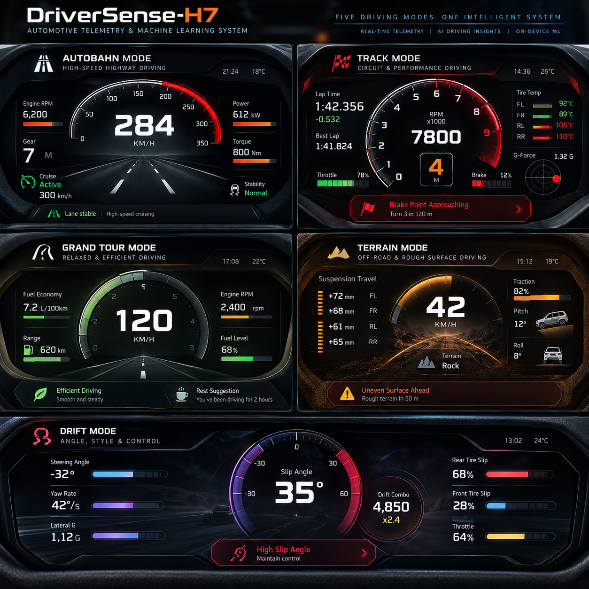

# DriverSense-H7 — Automotive Telemetry & Machine Learning System

**Custom STM32H7 embedded software · Real-time vehicle telemetry · CNN autoencoders · On-device ML research**

<p align="center">
  
</p>

DriverSense-H7 is a personal research and development project combining **low-level embedded systems engineering** with **machine learning for automotive telemetry analysis**.

The project has evolved from building a register-level Ethernet telemetry pipeline and OLED dashboard on an STM32H7 into a broader platform for **vehicle-state representation, driving-regime discovery, and resource-constrained on-device inference**.

Rather than treating machine learning as a replacement for conventional firmware, DriverSense-H7 explores how a custom real-time embedded platform can acquire and present telemetry while learned models extract useful representations from driving data.

> **Development status — May 2026–present**  
> **Embedded:** Custom Ethernet/networking and live OLED telemetry pipeline implemented; FreeRTOS and SystemView integrated.  
> **Machine learning:** CNN autoencoder models trained for vehicle telemetry analysis and driving-regime discovery using causal time-series windows and Optuna hyperparameter optimization.  
> **On-device ML:** Deployment of trained neural network encoders to STM32H7 is under investigation; **embedded inference is not yet presented as a completed feature**.

## Project at a glance

| Area | Current scope | Status |
| --- | --- | --- |
| Embedded networking | Custom RMII Ethernet MAC/DMA/PHY and ARP, IPv4, ICMP, UDP processing without LwIP | Implemented |
| Real-time firmware | FreeRTOS tasks for telemetry reception and OLED updates; Cortex-M7 DMA/cache handling | Integrated |
| Telemetry interface | Forza Data Out packet parsing and SSD1306 vehicle dashboard | Implemented |
| Development diagnostics | ST-LINK debugging, SEGGER SystemView/RTT and DWT timing support | Integrated |
| Machine learning research | CNN autoencoders, causal telemetry windows, Optuna hyperparameter optimization | Models trained |
| Edge AI | Porting neural network encoders to STM32H7 for on-device inference | Under investigation |
| Expansion | Telemetry logging, additional display options, vehicle-state analytics and track learning | Roadmap |

## 1. Embedded telemetry platform

The embedded subsystem runs on an **STM32H7S3L8 (Arm Cortex-M7)** using the **NUCLEO-H7S3L8** development board. A PC transmits live Forza Data Out telemetry over UDP. The microcontroller handles the Ethernet frames using custom C drivers and networking code, extracts vehicle signals, and renders them on an SSD1306 OLED.

### Embedded data path

```text
Forza Horizon / Forza Data Out (PC)
                |
            UDP / IPv4
                |
        Ethernet / RMII PHY
                |
     STM32H7 Ethernet MAC + DMA
                |
      Custom network processing
      ARP | IPv4 | ICMP | UDP
                |
       Forza telemetry parser
                |
        Dashboard data state
                |
        SSD1306 OLED display
```

### Custom drivers and networking

The firmware emphasizes register-level programming rather than relying on a complete high-level network stack.

- **Peripheral drivers:** RCC, GPIO, EXTI, NVIC, I2C, SSD1306 display support, and DWT timing utilities.
- **Ethernet interface:** RMII setup, LAN8742A PHY discovery and link management, MAC configuration, DMA descriptors, raw frame receive/transmit, and MTL queue configuration.
- **Network protocols:** Ethernet II parsing, ARP request/reply handling, IPv4 parsing and filtering, ICMP echo request/reply support, and UDP payload extraction.
- **Memory and cache coherency:** MPU-configured non-cacheable Ethernet RX memory; cacheable TX buffers with D-cache maintenance before DMA transmission; dedicated linker sections.
- **RX architecture:** Ethernet hardware uses **DMA** for packet transfer, while firmware checks descriptor/frame availability through **polling**. DMA operation does not imply interrupt-driven receive processing.

The Ethernet implementation is intentionally minimal and purpose-built. It is **not** a replacement for a full TCP/IP stack.

### Live telemetry and dashboard

The firmware validates and parses Forza Data Out telemetry, including engine RPM, speed, gear, steering, throttle/brake inputs, boost, tire-related signals, and distance. A reduced dashboard-state representation separates the telemetry decoder from display rendering.

The **128 × 64 SSD1306 OLED** uses framebuffer-based graphics to display driving information, including speed, gear, RPM visualization, selected vehicle indicators, and network/telemetry status screens. The dashboard is an implemented demonstrator of the embedded pipeline, rather than the project's final scope.

## 2. Real-time firmware and debugging

**FreeRTOS 202604 LTS** is integrated with the Arm Cortex-M7 portable layer and `heap_4.c`. The current application uses separate tasks for **telemetry reception** and **display updates**. The low-level Ethernet path remains custom and DMA-backed.

The project also incorporates:

- **SEGGER SystemView and RTT** for observing task scheduling, context switches, and execution behavior.
- **DWT cycle counter** support for timing and trace timestamps.
- **ST-LINK / STM32CubeIDE** for flashing, debugging, and trace snapshot workflows.
- **Task stack usage inspection** and FreeRTOS scheduling experiments.

Further work will focus on stronger inter-task data exchange, timeouts, resilience, and end-to-end runtime profiling.

## 3. Machine learning for vehicle telemetry

The machine learning component investigates **representation learning from automotive time-series data**. Its current research direction goes beyond manually assigning fixed thresholds to every driving condition.

### CNN autoencoder research

CNN autoencoder models have been **trained** for vehicle telemetry analysis and **driving-regime discovery**. The workflow includes:

- **Causal time-series windows**, constructed using historical telemetry samples rather than future observations.
- **CNN autoencoder models** for learning compact representations of telemetry behavior.
- **Optuna hyperparameter optimization** to explore model configurations.
- Investigation of learned representations as a basis for understanding different vehicle operating regimes.

This is an **offline model-development effort** at the current stage. Training a model does not, by itself, demonstrate successful STM32 deployment, real-time inference performance, or validated safety-critical predictions.

### Toward on-device inference

The next research step is to investigate deployment of **trained encoder networks** on the STM32H7, with attention to:

- Model size and memory footprint.
- CPU cost and inference latency.
- Possible quantization and embedded inference runtimes.
- Scheduling inference alongside Ethernet reception and display updates.
- Comparing embedded encoder outputs with offline reference results.

**No claim of completed on-device neural network inference is made at this stage.**

## 4. System architecture and intended evolution

```text
                     VEHICLE TELEMETRY
                   Forza Data Out / UDP
                            |
                            v
               +--------------------------+
               | STM32H7 embedded platform|
               | Ethernet MAC/DMA + PHY   |
               | Custom ARP / IPv4 / UDP  |
               +--------------------------+
                            |
                            v
                  Telemetry processing
                            |
                 +----------+----------+
                 |                     |
                 v                     v
           OLED dashboard       Future data services
           (implemented)         / logging pipeline
                                       |
                                       v
                           Encoder deployment research
                           (not yet integrated on MCU)

OFFLINE RESEARCH WORKFLOW
Telemetry datasets -> causal windows -> CNN autoencoder training
                   -> Optuna tuning -> learned representations
                   -> candidate encoder for STM32 deployment
```

The offline learning workflow and the embedded runtime are **distinct parts of the project today**. Their integration is a development goal.

## 5. Hardware and development environment

| Component | Technology |
| --- | --- |
| Microcontroller | STM32H7S3L8 / Arm Cortex-M7 |
| Development board | NUCLEO-H7S3L8 |
| Ethernet PHY/interface | LAN8742A / RMII |
| Display | SSD1306 OLED, 128 × 64, I2C |
| Embedded language | C |
| IDE/debug | STM32CubeIDE, ST-LINK |
| RTOS | FreeRTOS 202604 LTS |
| Timing/trace | DWT, SEGGER SystemView, SEGGER RTT |
| ML methods | CNN autoencoders, causal time-series windows, Optuna |

### Development network configuration

```text
STM32 IPv4 address : 192.168.1.50
STM32 MAC address  : 02:00:00:00:00:01
UDP telemetry port : 5005
Ethernet PHY       : LAN8742A
Interface          : RMII
```

These are **development/test configuration values**, not a claim of automatic network configuration or a production-ready networking setup.

## 6. Development roadmap

### Embedded and real-time systems

- Strengthen task communication and telemetry timeout/recovery behavior.
- Add more robust UDP and packet integrity checks, including UDP checksum validation.
- Extend execution-time and stack-use measurements.
- Develop SPI and SD-card support for logging and replay.
- Evaluate an expanded display interface for richer visualization.

### Machine learning and automotive analysis

- Evaluate learned encoder representations across driving conditions.
- Investigate model compression, quantization, and STM32H7 integration.
- Benchmark memory usage, latency, and scheduling overhead on target hardware.
- Explore applications such as driving behavior analysis, vehicle-state anomalies, and track-learning assistance.

Items above are **planned or investigative**, not completed production functionality.

## 7. Engineering objectives

DriverSense-H7 is intended to demonstrate and deepen practical experience in:

- Low-level embedded C and custom STM32 driver development.
- Ethernet MAC/DMA descriptor handling and lightweight network protocol implementation.
- Cortex-M7 MPU and cache coherency in DMA-based systems.
- FreeRTOS task architecture and runtime debugging.
- Real-time automotive telemetry acquisition and visualization.
- ML experimentation with multivariate, causal time-series data.
- Bridging offline model development with resource-constrained embedded inference.

## Project status

**Active personal project — May 2026–present.** Features and architecture are evolving as the embedded system and machine learning research progress. Technical claims in this README distinguish implemented embedded functionality, trained offline models, and future on-device inference work.
