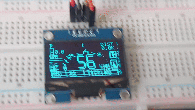

# DriverSense-H7

**Bare-metal STM32H7 telemetry engine with custom Ethernet networking, an OLED dashboard, FreeRTOS task architecture, and a roadmap toward TinyML-based driving analysis.**

<p align="center">
  
</p>

## Overview

DriverSense-H7 is an embedded systems project built around the STM32H7S3 microcontroller.

The system receives live vehicle telemetry from a PC over Ethernet, processes the packets directly on the STM32, and displays selected driving data on an SSD1306 OLED dashboard.

The project is developed primarily at register level using custom peripheral drivers and a minimal custom Ethernet stack rather than a high-level networking library.

The current implementation supports:

- Custom STM32H7Sxx peripheral drivers
- Bare-metal Ethernet MAC, DMA, and PHY control
- ARP and ICMP communication
- UDP telemetry reception
- Forza Data Out packet parsing
- Real-time SSD1306 dashboard rendering
- FreeRTOS-based task experiments
- SEGGER SystemView task and timing analysis

The long-term roadmap includes telemetry logging, higher-level vehicle-state analysis, and TinyML inference for driving behavior and anomaly detection.

---

## Current Status

The project has reached a working real-time telemetry dashboard milestone.

The STM32 currently:

1. Initializes the RMII Ethernet interface and LAN8742A PHY
2. Receives raw Ethernet frames through DMA descriptors
3. Responds to ARP requests
4. Responds to ICMP Echo Requests
5. Receives UDP telemetry packets
6. Validates and parses Forza Data Out packets
7. Extracts vehicle telemetry fields
8. Renders the processed data on an SSD1306 OLED dashboard

Verified communication includes:

```text
ARP resolution
192.168.1.50 -> 02:00:00:00:00:01

ICMP
Reply from 192.168.1.50

UDP telemetry
Destination port: 5005
```

---

## System Architecture

```text
Forza Horizon
      │
      │ UDP telemetry
      ▼
PC Ethernet Interface
      │
      │ Raw Ethernet frames
      ▼
STM32H7 Ethernet MAC + DMA
      │
      ├── Ethernet II parsing
      ├── ARP handling
      ├── IPv4 filtering
      ├── ICMP handling
      └── UDP payload extraction
                │
                ▼
       Forza Packet Parser
                │
                ▼
      Reduced Dashboard State
                │
                ▼
       SSD1306 OLED Renderer
```

The future architecture will separate these stages into FreeRTOS tasks and lightweight telemetry services.

---

## Hardware

- STM32H7S3L8H6
- NUCLEO-H7S3L8
- Arm Cortex-M7
- LAN8742A Ethernet PHY
- RMII Ethernet interface
- SSD1306 128 × 64 OLED
- I2C display connection
- On-board STLINK-V3EC debugger

---

## Software Environment

- Bare-metal C
- STM32CubeIDE
- FreeRTOS 202604 LTS
- SEGGER SystemView
- SEGGER RTT
- ST-LINK debugging
- Register-level STM32 peripheral access

SystemView traces are currently captured through snapshot analysis using ST-LINK and STM32CubeIDE.

---

## Custom Driver Layer

The project includes custom register-level drivers for the STM32H7Sxx family.

### Implemented

- STM32H7Sxx memory map definitions
- RCC peripheral clock control
- GPIO initialization and deinitialization
- GPIO input and output APIs
- BSRR-based GPIO writes
- ODR-based GPIO toggle
- EXTI interrupt configuration
- NVIC interrupt configuration
- I2C driver
- SSD1306 OLED driver
- DWT cycle-counter delay support
- Ethernet MAC, DMA, and PHY driver

### Planned

- UART driver
- SPI driver
- SD card interface
- Additional timer and DMA support

---

## Ethernet Stack

The project uses a custom minimal Ethernet implementation without LwIP.

### MAC and DMA

- RMII GPIO configuration
- Ethernet peripheral clock setup
- PHY address detection
- PHY link-state polling
- Auto-negotiation handling
- MAC address configuration
- DMA RX descriptor ring
- DMA TX descriptor ring
- MTL RX and TX queue configuration
- Raw Ethernet frame reception
- Raw Ethernet frame transmission

### Cache and Memory Handling

The Cortex-M7 data cache requires explicit coherency handling for Ethernet DMA.

Current memory strategy:

- MPU-based non-cacheable region for RX descriptors
- MPU-based non-cacheable region for RX buffers
- Separate cacheable TX buffer section
- D-cache clean before DMA transmission
- Dedicated linker sections for Ethernet memory

### Network Protocol Support

- Ethernet II frame parsing
- ARP request parsing
- ARP reply generation
- IPv4 destination filtering
- IPv4 header parsing
- ICMP Echo Request parsing
- ICMP Echo Reply generation
- IPv4 checksum calculation
- ICMP checksum calculation
- UDP header parsing
- UDP destination-port filtering
- UDP payload extraction

---

## Forza Telemetry Parser

The parser currently supports fixed-size Forza Data Out packets.

Implemented parsing includes:

- Packet-size validation
- Little-endian integer extraction
- Little-endian floating-point extraction
- Speed conversion from m/s to km/h
- Current RPM
- Maximum RPM
- Gear
- Throttle
- Brake
- Clutch
- Handbrake
- Steering
- Tire slip values
- Tire temperatures
- Fuel level
- Boost pressure
- Distance traveled

A reduced dashboard structure is used so that the OLED rendering layer does not depend directly on the complete Forza packet.

---

## OLED Dashboard

The dashboard is rendered using a framebuffer-based SSD1306 driver.

### Rendering Features

- 5 × 7 bitmap font
- Large seven-segment-style numbers
- Pixel drawing
- Line drawing
- Rectangle drawing
- Filled rectangles
- Horizontal and vertical bar indicators
- Framebuffer-based screen updates

### Dashboard Features

- Startup information screen
- Network status screen
- Waiting-for-telemetry screen
- Large speed display
- Dynamic gear display
- RPM arc scaled using vehicle maximum RPM
- Turbo indicator
- Fuel indicator
- Distance display
- Throttle and brake status
- Tire slip warnings
- Tire temperature information
- Shift-up indicator
- Shift-down indicator
- Bottom warning and status bar

---

## FreeRTOS Progress

FreeRTOS has been integrated as the next step toward separating the telemetry pipeline into independent real-time components.

Current FreeRTOS work includes:

- FreeRTOS 202604 LTS integration
- ARM Cortex-M7 portable layer
- `heap_4.c` dynamic memory allocation
- Task creation and scheduling tests
- Multi-task LED timing test
- `vTaskDelay()` timing experiments
- Task stack monitoring
- DWT-based runtime timestamp source

Current test tasks run at different periods to verify scheduling behavior:

```text
LD1 task: 1000 ms
LD2 task:  500 ms
LD3 task:  100 ms
```

Planned task architecture:

```text
Ethernet RX Task
      │
      ▼
Telemetry Parser Task
      │
      ▼
Dashboard Update Task
      │
      ├── Warning Analysis
      ├── Logging
      └── Future TinyML Inference
```

---

## SEGGER SystemView

SEGGER SystemView is used to inspect FreeRTOS scheduling behavior and execution timing.

Current integration includes:

- SEGGER RTT
- SEGGER SystemView
- FreeRTOS trace integration
- DWT cycle counter as timestamp source
- Cortex-M7 active exception tracking
- Task execution visualization
- SysTick visualization
- Context-switch analysis
- Snapshot capture through ST-LINK and STM32CubeIDE

SystemView is currently used primarily to verify:

- Task scheduling
- Task execution duration
- Delay behavior
- Idle-task activity
- Context switches
- Interrupt timing

---

## Current Network Configuration

```text
STM32 IPv4 address : 192.168.1.50
STM32 MAC address  : 02:00:00:00:00:01
UDP telemetry port : 5005
Ethernet PHY       : LAN8742A
Interface          : RMII
```

---

## Current Milestone

The current prototype demonstrates a complete basic telemetry path:

```text
PC telemetry
    -> Ethernet frame reception
    -> IPv4 and UDP parsing
    -> Forza packet decoding
    -> Dashboard-state generation
    -> OLED framebuffer rendering
```

This confirms that the STM32 can participate in basic IP communication and process live telemetry using a custom bare-metal networking implementation.

---

## Next Milestone

The next milestone is to convert the working pipeline into a more structured real-time architecture.

Planned work:

- Separate Ethernet, parsing, and display logic into FreeRTOS tasks
- Add queues or task notifications between pipeline stages
- Improve UDP payload validation
- Add UDP checksum verification using the IPv4 pseudo-header
- Improve Forza packet validation and parser robustness
- Add telemetry timeout detection
- Add network reconnect handling
- Improve OLED layout and warning icons
- Add lightweight event and error counters
- Add stack-usage monitoring
- Add execution-time measurements with SystemView
- Add SPI and SD card support
- Prepare telemetry logging for offline analysis

---

## TinyML Roadmap

TinyML is a future inference layer and is not yet part of the current working prototype.

Potential inference targets include:

- Driving behavior classification
- Traction-loss prediction
- Tire-grip estimation
- Brake-fade detection
- Driver coaching
- Powertrain anomaly detection
- Unsafe vehicle-state detection
- Lap and performance analysis
- Track-learning support

The initial approach is expected to use models trained offline on a PC and deployed to the STM32 for inference.

---

## Planned Features

- FreeRTOS telemetry task architecture
- Queue-based telemetry pipeline
- UART driver
- SPI driver
- SD card logging
- UDP checksum validation
- Improved dashboard interface
- Vehicle-state warning system
- Telemetry timeout and recovery logic
- SystemView runtime analysis
- CMSIS-DSP integration
- TinyML inference
- Track-learning mode
- Optional per-vehicle model loading

---

## Project Goals

DriverSense-H7 is intended to demonstrate:

- Register-level STM32 driver development
- Cortex-M7 cache and MPU management
- Ethernet DMA descriptor handling
- Custom Ethernet protocol processing
- Real-time UDP telemetry parsing
- Embedded graphical interface development
- FreeRTOS task design
- Real-time trace and timing analysis
- Resource-aware embedded machine learning

The final goal is a compact real-time embedded telemetry platform capable of receiving vehicle data, displaying live information, detecting abnormal conditions, and eventually performing TinyML inference directly on an STM32 microcontroller.

---

## Development Status

This project is under active development.

Implemented features may change as the driver architecture, networking layer, FreeRTOS integration, and dashboard interface are refined.
